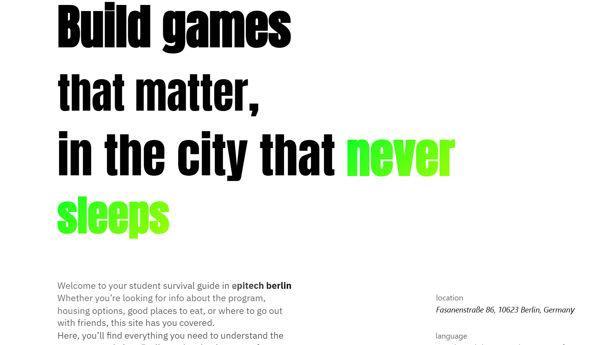
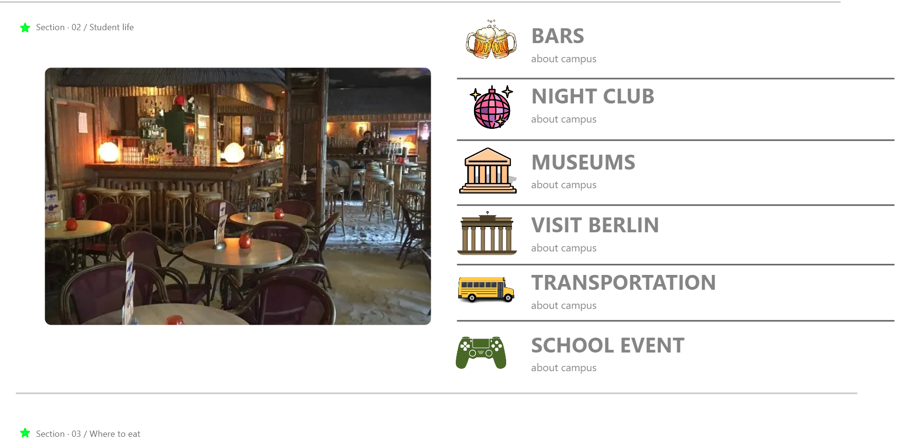
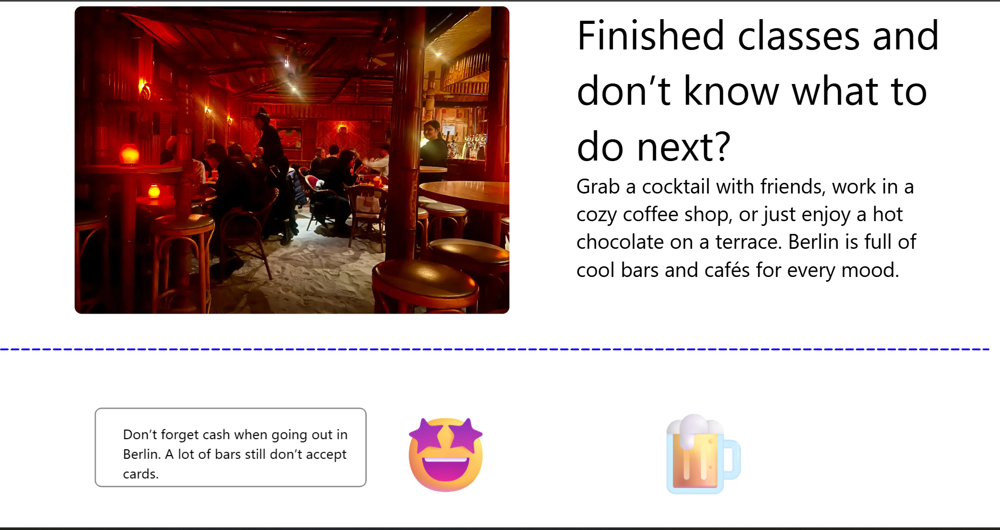
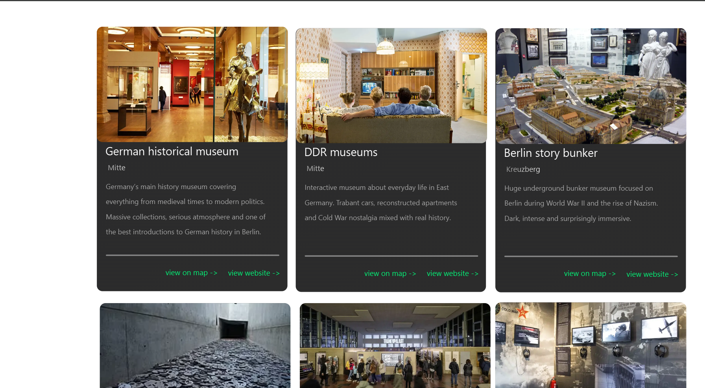
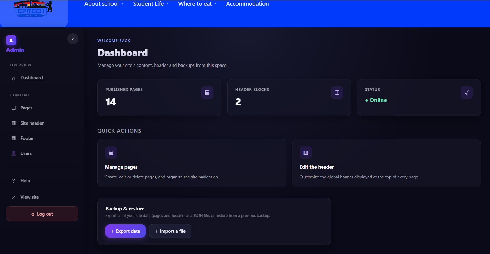
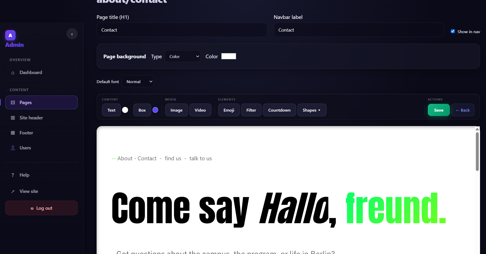

# Epitech Berlin | Student Platform

**A full-stack web platform designed to help students discover Epitech Berlin, explore campus life, and access practical information through a customizable content management system.**

Developed as a collaborative student project at Epitech.

## Overview

The Epitech Berlin Student Platform aims to centralize useful information for current and future students, including accommodation, transportation, campus activities, and everyday life in Berlin.

Beyond a traditional informational website, the project includes a custom content management system (CMS), allowing administrators to create and manage pages, customize the website's appearance, and organize content through an interactive visual editor.

The platform combines a student-facing website with an administration interface, providing both an accessible user experience and flexible content management tools.

## Key Features

### Student Website

- Information about Epitech Berlin and campus life
- Practical guides for accommodation, transportation, and student activities
- Dynamic pages powered by a custom CMS
- Responsive layouts and interactive components
- Consistent visual identity and intuitive navigation

### Custom Content Management System

- Create, edit, and manage dynamic website pages
- Visual page editor with customizable content blocks
- Text and image editing tools
- Drag-and-drop-style content positioning and resizing
- Customizable headers, footers, and page layouts
- Page settings and content organization
- Interactive editing tools and contextual menus

### Administration Interface

- Administrator authentication
- Protected administration routes
- Administration dashboard
- Page management interface
- User management interface
- Website appearance and settings management

## Tech Stack

| Category | Technologies |
|---|---|
| Frontend | React, TypeScript, Vite |
| Styling | CSS |
| Backend | Node.js, Express.js |
| Database | MongoDB, Mongoose |
| Authentication | JWT, bcrypt |
| Frontend Testing | Vitest |
| Development | Docker, Docker Compose |

## My Contributions

As part of this collaborative Epitech project, I was responsible for the frontend development, UI/UX design, visual content management system, and administration interfaces.

My work covered both the technical implementation and the visual design of the platform.

### Frontend Development

- Developed the student-facing website using React and TypeScript.
- Built reusable components and interactive user interfaces.
- Implemented dynamic page rendering and frontend navigation.
- Integrated frontend features with the backend API developed by other team members.
- Improved responsiveness and usability across the platform.

### UI/UX Design

- Designed the visual identity and overall appearance of the website.
- Defined page layouts, color schemes, typography, and component styling.
- Created intuitive navigation and consistent interface patterns.
- Designed the student website and administration interfaces.
- Focused on accessibility, readability, and user experience.

### Custom CMS Development

- Developed the visual page editor used to create and customize website pages.
- Implemented editable text, images, and customizable content blocks.
- Built interactive tools for positioning, resizing, and editing elements.
- Developed contextual menus and editing controls.
- Implemented website customization features, including headers, footers, and page layouts.

### Administration Interface

- Developed the administration dashboard and management interfaces.
- Created interfaces for managing pages, users, and website settings.
- Implemented frontend interactions for administrative features.
- Integrated administration components with the application's backend services.

### Testing and Debugging

- Tested frontend components and interactions.
- Identified and fixed interface bugs.
- Improved the stability and maintainability of frontend features.

### Team Collaboration

This project was developed collaboratively with other Epitech students.

My responsibilities focused on frontend development, UI/UX design, the custom CMS, and administration interfaces. Backend development and database management were handled by other team members.

## Project Structure

```text
epitech-berlin-platform/
├── front/               # React frontend and CMS interface
├── back/                # Express API and database models
├── docker-compose.yml   # Docker development configuration
└── README.md
```

## Getting Started

### Prerequisites

- Node.js and npm
- A MongoDB database (local or MongoDB Atlas)

### 1. Clone the Repository

```bash
git clone https://github.com/quentin-charillon/epitech-berlin-platform.git
cd epitech-berlin-platform
```

### 2. Configure the Backend

```bash
cd back
npm install
```

Copy `.env.example` to `.env` and configure the required environment variables:

```env
PORT=5000
MONGO_URI=your_mongodb_connection_string
JWT_SECRET=your_jwt_secret
ADMIN_EMAIL=admin@example.com
ADMIN_PASSWORD=your_admin_password
ADMIN_NAME=Admin
```

Never commit real credentials or environment files to the repository.

### 3. Start the Backend

```bash
npm run dev
```

### 4. Start the Frontend

Open a separate terminal from the repository root:

```bash
cd front
npm install
npm run dev
```

The frontend should be available at:

http://localhost:5173


## Screenshots

### Homepage



### studentLife



### activity



### Museums Page



### Administration Dashboard



### Visual CMS Editor



## Project Status

Academic collaborative project developed at Epitech.

This repository showcases the application's frontend architecture, custom CMS, administration interfaces, and supporting backend services.

## Author & Contributors

**Quentin Charillon**

Epitech Student | Frontend Development | UI/UX Design | Full-Stack Project Experience

**Main contributions:** Frontend development, UI/UX design, custom CMS, and administration interfaces.

**Backend and database:** Developed by other project team members.


## 🌐 Live Demo & Admin Access

The Epitech Berlin Student Platform is deployed and available online.
Please note: This project uses Render's free hosting tier for the backend, which automatically goes to sleep after a period of inactivity.

As a result, the first visit may take approximately 30–60 seconds to load data while the server wakes up.

Thank you for your patience! Subsequent requests should be much faster

### Student Website

🔗 **[Visit the Student Platform](https://epitech-berlin-platform.vercel.app/)**

Explore the website, discover student life in Berlin, and navigate through the different pages.

### 🛠️ Try the Administration Dashboard

🔗 **[Access the Admin Dashboard](https://epitech-berlin-platform.vercel.app/admin/login)**

Want to explore how the platform works behind the scenes?

A demo administrator account is available for recruiters, developers, and visitors interested in testing the custom CMS.

**Demo Credentials:**
- **Email:** quentin.charillon@epitech.eu
- **Password:** Hermes2004

With this account, you can:
- Explore the administration dashboard
- Create and edit website pages
- Customize content using the visual CMS editor
- Modify text, images, headers, and footers
- Test the interactive editing tools
- Explore website settings and customization features

Feel free to experiment with the CMS and discover its capabilities!

### Deployment Architecture

- **Frontend:** Vercel
- **Backend:** Render
- **Database:** MongoDB Atlas


[GitHub Profile](https://github.com/quentin-charillon)
